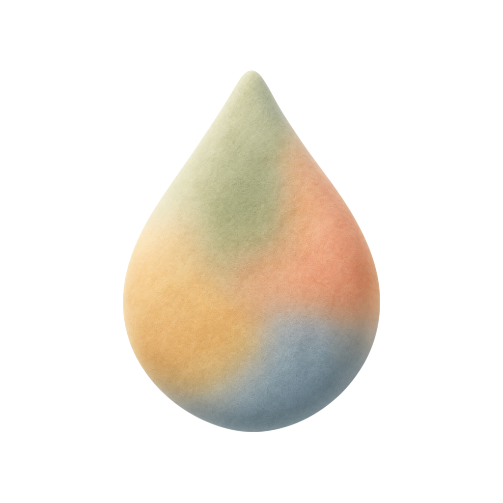
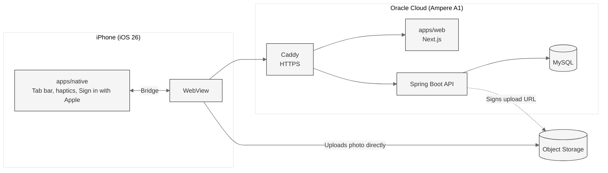

<a name="readme-top"></a>

<div align="center">



# dam.

**An iOS app that records each day as one color picked from a photo**

<a href="https://apps.apple.com/kr/app/id6809452180">App Store</a> |
<a href="https://github.com/hjkim0905/dam_BE">Backend repo</a> |
<a href="https://bbin-guuuu.tistory.com/category/%EA%B0%9C%EC%9D%B8%20%ED%94%84%EB%A1%9C%EC%A0%9D%ED%8A%B8%28%EB%8B%B4.%29">Dev blog (Korean)</a>


<strong>Language:</strong> <a href="README.md">한국어</a> | English

[Why](#why-i-built-it) | [Architecture](#architecture) | [Problem solving](#problem-solving) | [How I work](#how-i-work) | [Run](#run)

</div>

<p align="center">
  
  
  
  
  
  
</p>

<br>

> [!NOTE]
> A solo project: I handled planning, design, frontend, backend, and infrastructure.
> Development started in August 2026. The app is live on the App Store and still in operation.

<br>

## Why I built it

Many people want to keep a diary, but writing every day feels like a chore.

dam. records a day as **a single color** instead of words.

- Pick one color from a photo you took today.
- The colors stack up on a calendar, and each month becomes one gradient.
- Two people can share a room and fill in their days side by side.

**I checked demand before building.**
Interviews ruled out my first hypothesis, so I posted a 19-second concept video before writing any app code.
I set a goal of 20 reactions, got 31, and only then started development. ([blog](https://bbin-guuuu.tistory.com/124))

<br>

## Features

| Feature | Description |
|---|---|
| Color picking | Upload a photo and pick a color from it as today's color |
| Calendar | Saved colors fill the date cells. Tap a date to see that day's photo and memo |
| Shared room | Invite someone with a 6-digit code and fill one calendar together |
| Localization | Korean, English, and Japanese |

<br>

## dam. in numbers

| Metric | Result |
|---|---|
| First-record conversion | 22 of 42 installers completed their first record |
| Calendar photo load | 1.0-2.3s per photo → 65-116ms |
| One month of photos | 3.47MB → 0.50MB (31 photos) |
| Server load when flipping months | Requests 8 → 6 (25% fewer), DB queries 26 → 20 (23% fewer) |
| Monthly infrastructure cost | $0 (free cloud tier only) |

<br>

## Architecture

Screens are built as a web app (Next.js), and a React Native (Expo) app shows that web app in a WebView.



### Floating UI is native, the content between is web

iOS 26 Liquid Glass cannot be imitated with CSS.
Refraction, lighting, and touch-driven morphing are all handled by the system.

| Where | What |
|---|---|
| Native | Tab bar (`NativeTabs` from `expo-router`, a real `UITabBarController`) |
| Web | All the content in between (color drops, gradients, photos, memos) |

Instead of drawing the glass myself, I used the system tab bar.
Apple now draws scroll-to-minimize, accessibility, and the next OS's design changes for me.

### Screen state lives only in the web app

With the tab bar moved to native, screen state could end up in two places.

Native only tells the web app that a tab was tapped.
The web app decides where to go and reports the result back to native.
If native changed screens on its own, the two states would drift apart and the back button would land in the wrong place.

<br>

## Problem solving

**Calendar photos loaded one by one, slowly.**
Attaching Safari Web Inspector to a real device showed that a 640px original was being sent to a 165px cell.
The server was also issuing a new photo URL on every request, so photos already seen were downloaded again.
I resized images to the cell size with `next/image` and changed the server to issue a new URL only when less than half of its lifetime remains.
Load time per photo dropped from 1.0-2.3s to 65-116ms. ([blog](https://bbin-guuuu.tistory.com/125))

**Flipping the calendar refetched months already seen.**
Records were held only in component state (`useState`), so there was no cache.
I introduced TanStack Query and set the stale time by the nature of each record.
My own records get 5 minutes, because the cache is cleared the moment I save one. Shared records get 30 seconds, because the other person can edit at any time.
Server requests fell by 25% and DB queries by 23%. ([blog](https://bbin-guuuu.tistory.com/129), [code](apps/web/src/app/use-entries.ts))

**The AI often ignored rules written in docs.**
Working alone with AI meant no one reviewed the code.
I turned the rules from documents into hooks (checks that run automatically), so they run the moment the AI tries to finish a task.
If a check fails, the AI fixes it before the work reaches me.
Later I counted that the model review hook misfired 249 out of 261 times, found the cause through experiments, and fixed it. ([blog](https://bbin-guuuu.tistory.com/126), [settings](.claude/settings.json))

<br>

## How I work

### AI workflow (Claude Code harness)

Rules a machine can check are enforced by [`.claude/hooks/`](.claude/hooks), not by [`CLAUDE.md`](CLAUDE.md).

| Level | When | What |
|---|---|---|
| L1 | Every file edit | Checks rules like Emotion setup order and hard-coded px values and tells the AI. Does not block mid-task ([`verify-syntax.sh`](.claude/hooks/verify-syntax.sh)) |
| L2 | When finishing a task | Runs typecheck, tests, and lint. Blocks finishing on failure ([`verify-regression.sh`](.claude/hooks/verify-regression.sh)) |
| L3 | When finishing a task | A model reads changed files and reviews for missing tests, mixed concerns, and unnecessary comments |

### Testing

- Logic (pure functions, parsers, and transforms in `lib/` and `utils/`) is tested first.
- Screens (`app/**/*.tsx`) are not tested. Tests that copy style values catch no bugs and must change with every design change.
- Tests use `node:test` with no framework and run with `tsx --test`.

### Branches and deployment

- **GitHub Flow**: a [`pre-push` hook](.githooks/pre-push) blocks direct pushes to `main`. CI checks branch names and commit message format again.
- **CI**: every PR runs typecheck, tests, lint, and build. ([`ci.yml`](.github/workflows/ci.yml))
- **CD**: merging into `main` deploys to the server and rolls back to the previous version if the health check fails. This rollback kicked in during the first real deployment failure. ([`release-web.sh`](deploy/release-web.sh))

<br>

## Tech stack

| Area | Choice | Why |
|---|---|---|
| Web | Next.js 15, React 19, TypeScript 5 | One web codebase for all screens, shipped without app review |
| Server state | TanStack Query 5 | Different stale times per kind of record |
| Styling | Emotion 11 (`css` prop) | Colors and spacing come only from CSS variables in `globals.css` |
| App | React Native 0.86, Expo 57 | Draws the Liquid Glass tab bar with a system component and handles only what the web cannot, like haptics |
| Font | Galmuri14 | A pixel font designed at 14px, so sizes are multiples of 14 and hierarchy comes from size, not weight |
| Monitoring | PostHog, Sentry | Photo and memo contents are never sent to analytics (only memo length) |

<br>

<details>
<summary><b>Folder structure</b></summary>

```
apps/
├─ native/                 Expo app (WebView shell)
│  ├─ app/                 Tab bar and screen entry points (expo-router)
│  ├─ lib/                 Bridge, session, i18n
│  ├─ locales/             Korean, English, Japanese
│  └─ plugins/             Expo config plugins
└─ web/                    Next.js web (the actual screens)
   └─ src/
      ├─ app/              Calendar, recording flow, room, day detail
      └─ lib/              Color math, calendar, records, bridge (with tests)
.claude/                   AI workflow (hooks, skills)
.githooks/                 Commit message and push rules
deploy/                    Web deploy scripts
```

</details>

<br>

## Run

```bash
yarn install

yarn web      # Web (http://localhost:3000)
yarn native   # Native (start the web app first)
yarn ios      # Simulator
```

Create each app's `.env` by copying its `.env.example`.

- `apps/native/.env`: `WEB_URL` (the URL the WebView loads)
- `apps/web/.env`: `NEXT_PUBLIC_API_URL` (backend URL)

Only iOS 26 and later are supported. The backend lives in [dam_BE](https://github.com/hjkim0905/dam_BE).

<br>

<div align="right"><a href="#readme-top">Back to top</a></div>
