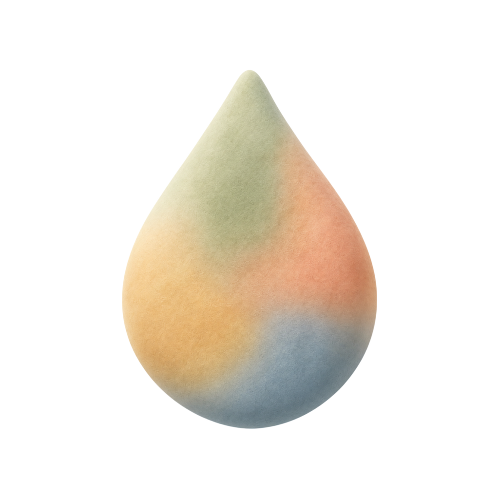
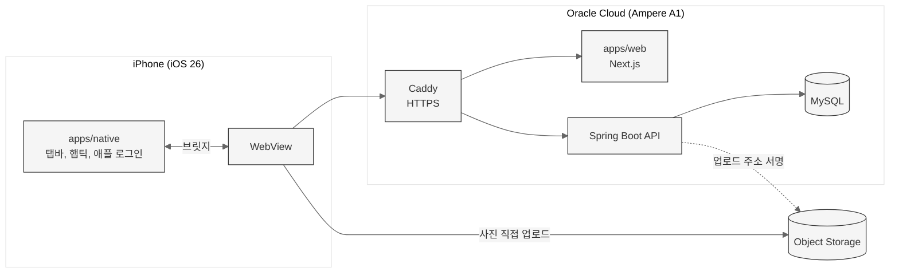

<a name="readme-top"></a>

<div align="center">



# 담.

**사진에서 고른 색 하나로 하루를 남기는 iOS 앱**

<a href="https://apps.apple.com/kr/app/id6809452180">App Store</a> |
<a href="https://github.com/hjkim0905/dam_BE">백엔드 레포</a> |
<a href="https://bbin-guuuu.tistory.com/category/%EA%B0%9C%EC%9D%B8%20%ED%94%84%EB%A1%9C%EC%A0%9D%ED%8A%B8%28%EB%8B%B4.%29">개발 블로그</a>


[왜 만들었나](#왜-만들었나) | [아키텍처](#아키텍처) | [문제 해결](#문제-해결) | [개발 방식](#개발-방식) | [실행](#실행)

</div>

<p align="center">
  
  
  
  
  
  
</p>

<br>

> [!NOTE]
> 기획, 디자인, 프론트엔드, 백엔드, 인프라를 혼자 맡은 개인 프로젝트입니다.
> 2026년 8월에 개발을 시작해 App Store에 출시했고 지금도 운영 중입니다.

<br>

## 왜 만들었나

일기를 쓰고 싶어도 매일 글을 쓰기는 부담스럽습니다.

담.은 하루를 글이 아니라 **색 하나**로 남깁니다.

- 오늘 찍은 사진 한 장에서 색 하나를 고릅니다.
- 고른 색이 달력에 쌓여 한 달이 하나의 그라데이션이 됩니다.
- 둘이 한 방에 들어가면 서로의 하루를 나란히 채워 갑니다.

**만들기 전에 수요부터 확인했습니다.**
처음 세운 가설은 인터뷰에서 버렸고, 앱 대신 19초짜리 소개 영상을 먼저 올려 반응을 쟀습니다.
목표로 잡은 반응 20개를 31개로 넘긴 뒤에 개발을 시작했습니다. ([블로그](https://bbin-guuuu.tistory.com/124))

<br>

## 주요 기능

| 기능 | 설명 |
|---|---|
| 색 고르기 | 사진을 올리면 그 안에서 색을 골라 오늘의 색으로 저장합니다 |
| 달력 | 기록한 색이 날짜 칸에 쌓이고, 날짜를 누르면 그날의 사진과 메모가 나옵니다 |
| 함께 쓰는 방 | 6자리 초대 코드로 상대를 초대해 한 달력을 같이 채웁니다 |
| 다국어 | 한국어, 영어, 일본어를 지원합니다 |

<br>

## 숫자로 본 담.

| 항목 | 결과 |
|---|---|
| 첫 기록 전환 | 설치한 42명 중 22명이 첫 기록까지 완료 |
| 달력 사진 로딩 | 한 장당 1.0-2.3초 → 65-116ms |
| 한 달 치 사진 용량 | 31장 기준 3.47MB → 0.50MB |
| 달력 넘길 때 서버 부하 | 요청 8 → 6번 (25% 감소), DB 쿼리 26 → 20개 (23% 감소) |
| 월 인프라 비용 | 0원 (무료 클라우드 구간만 사용) |

<br>

## 아키텍처

화면은 웹(Next.js)으로 만들고, React Native(Expo) 앱이 그 웹을 WebView로 띄웁니다.



### 떠 있는 것은 네이티브, 그 사이 콘텐츠는 웹

iOS 26의 리퀴드글래스는 CSS로 흉내 낼 수 없습니다.
굴절과 광원, 터치에 따른 변형이 전부 시스템의 몫이기 때문입니다.

| 어디 | 무엇 |
|---|---|
| 네이티브 | 탭바 (`expo-router`의 `NativeTabs`, 실제 `UITabBarController`) |
| 웹 | 그 사이 콘텐츠 전부 (색 방울, 그라데이션, 사진, 메모) |

유리를 직접 그리지 않고 시스템 탭바를 썼습니다.
그래서 스크롤 축소와 접근성 대응, 다음 OS의 디자인 변경까지 애플이 그려 줍니다.

### 화면 상태는 웹에만 둔다

탭바가 네이티브로 나가면서 화면 상태가 두 군데 생길 수 있습니다.

네이티브는 "눌렸다"는 사실만 웹에 보냅니다.
어디로 갈지는 웹이 정하고, 결과만 네이티브에 알려 줍니다.
네이티브가 스스로 화면을 바꾸면 두 상태가 어긋나 뒤로가기가 엉뚱한 곳으로 가기 때문입니다.

<br>

## 문제 해결

**달력 사진이 한 장씩 늦게 뜨던 문제.**
실기기에 Safari 웹 인스펙터를 붙여 보니, 165px 칸에 640px 원본이 그대로 오고 있었습니다.
게다가 서버가 요청마다 사진 주소를 새로 발급해 이미 본 사진도 다시 받고 있었습니다.
`next/image`로 칸 크기에 맞게 줄이고, 사진 주소는 유효기간이 절반 아래로 남았을 때만 새로 발급하게 바꿨습니다.
한 장 로딩이 1.0-2.3초에서 65-116ms로 줄었습니다. ([블로그](https://bbin-guuuu.tistory.com/125))

**달력을 넘길 때마다 이미 본 달을 다시 받던 문제.**
기록을 화면 상태(`useState`)에만 들고 있어 캐시가 없었습니다.
TanStack Query를 도입하고, 다시 받지 않는 시간을 기록의 성격에 따라 나눴습니다.
내 기록은 내가 담는 순간 캐시를 버리니 5분, 함께 보는 기록은 상대가 언제 고칠지 몰라 30초입니다.
서버 요청이 25%, DB 쿼리가 23% 줄었습니다. ([블로그](https://bbin-guuuu.tistory.com/129), [코드](apps/web/src/app/use-entries.ts))

**AI가 문서에 적은 규칙을 자주 무시하던 문제.**
혼자 AI와 개발하다 보니 코드를 봐 줄 리뷰어가 없었습니다.
규칙을 문서가 아니라 훅(자동으로 실행되는 검사)으로 바꿔, AI가 작업을 끝내려는 순간 검사가 돌게 했습니다.
실패하면 사람에게 오기 전에 AI가 먼저 고칩니다.
그 뒤 모델 리뷰 훅이 261번 중 249번 헛짚은 것을 세고, 실험으로 원인을 찾아 고쳤습니다. ([블로그](https://bbin-guuuu.tistory.com/126), [설정](.claude/settings.json))

<br>

## 개발 방식

### AI 작업 환경 (Claude Code 하네스)

기계가 판정할 수 있는 규칙은 [`CLAUDE.md`](CLAUDE.md)가 아니라 [`.claude/hooks/`](.claude/hooks)가 강제합니다.

| 단계 | 언제 | 무엇을 |
|---|---|---|
| L1 | 파일을 고칠 때마다 | Emotion 설정 순서, px 고정값 같은 규칙을 검사해 AI에게 알려 줌. 작업 중에는 막지 않음 ([`verify-syntax.sh`](.claude/hooks/verify-syntax.sh)) |
| L2 | 작업을 끝내려 할 때 | 타입 검사, 테스트, 린트를 돌리고 실패하면 끝내지 못하게 막음 ([`verify-regression.sh`](.claude/hooks/verify-regression.sh)) |
| L3 | 작업을 끝내려 할 때 | 바뀐 파일을 모델이 읽고 테스트 누락, 관심사 분리 위반, 불필요한 주석을 리뷰 |

### 테스트

- 로직(`lib/`, `utils/`의 순수 함수, 파서, 변환)은 테스트를 먼저 씁니다.
- 화면(`app/**/*.tsx`)은 테스트하지 않습니다. 스타일 값을 그대로 옮긴 테스트는 버그를 잡지 못하고 디자인을 바꿀 때마다 같이 고쳐야 하기 때문입니다.
- 프레임워크 없이 `node:test`로 쓰고 `tsx --test`로 돌립니다.

### 브랜치와 배포

- **GitHub Flow**: `main`에 직접 push하면 [`pre-push` 훅](.githooks/pre-push)이 막습니다. 브랜치 이름과 커밋 메시지 형식은 CI에서 한 번 더 검사합니다.
- **CI**: PR마다 타입 검사, 테스트, 린트, 빌드를 돌립니다. ([`ci.yml`](.github/workflows/ci.yml))
- **CD**: `main`에 병합되면 서버에 배포하고, 헬스체크에 실패하면 이전 버전으로 되돌립니다. 실제 첫 배포 장애 때 이 복구가 동작했습니다. ([`release-web.sh`](deploy/release-web.sh))

<br>

## 기술 스택

| 영역 | 선택 | 왜 |
|---|---|---|
| 웹 | Next.js 15, React 19, TypeScript 5 | 화면을 웹 하나로 만들어 앱 심사 없이 배포합니다 |
| 서버 상태 | TanStack Query 5 | 기록마다 다시 받지 않는 시간을 다르게 줄 수 있습니다 |
| 스타일 | Emotion 11 (`css` prop) | 색과 간격은 `globals.css`의 CSS 변수로만 씁니다 |
| 앱 | React Native 0.86, Expo 57 | 리퀴드글래스 탭바를 시스템 컴포넌트로 그리고, 햅틱처럼 웹에서 못 하는 일만 맡깁니다 |
| 폰트 | 갈무리(Galmuri14) | 14px 설계의 픽셀 폰트라 크기는 14의 배수로만 쓰고, 위계는 굵기 대신 크기로 줍니다 |
| 모니터링 | PostHog, Sentry | 사진과 메모 내용은 분석 도구로 보내지 않습니다 (메모는 길이만 보냄) |

<br>

<details>
<summary><b>폴더 구조</b></summary>

```
apps/
├─ native/                 Expo 앱 (WebView 셸)
│  ├─ app/                 탭바와 화면 진입점 (expo-router)
│  ├─ lib/                 브릿지, 세션, 다국어
│  ├─ locales/             한국어, 영어, 일본어
│  └─ plugins/             Expo config plugin
└─ web/                    Next.js 웹 (실제 화면)
   └─ src/
      ├─ app/              달력, 기록 흐름, 방, 하루 상세
      └─ lib/              색 계산, 달력, 기록, 브릿지 (테스트 포함)
.claude/                   AI 작업 환경 (훅, 스킬)
.githooks/                 커밋 메시지, push 규칙
deploy/                    웹 배포 스크립트
```

</details>

<br>

## 실행

```bash
yarn install

yarn web      # 웹 (http://localhost:3000)
yarn native   # 네이티브 (웹이 먼저 떠 있어야 합니다)
yarn ios      # 시뮬레이터
```

`.env`는 각 앱의 `.env.example`을 복사해서 만듭니다.

- `apps/native/.env`: `WEB_URL` (WebView가 띄울 주소)
- `apps/web/.env`: `NEXT_PUBLIC_API_URL` (백엔드 주소)

iOS 26 이상만 지원합니다. 백엔드는 [dam_BE](https://github.com/hjkim0905/dam_BE)에 있습니다.

<br>

<div align="right"><a href="#readme-top">맨 위로</a></div>
